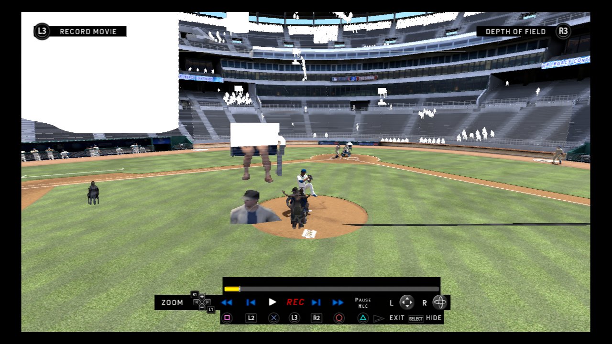
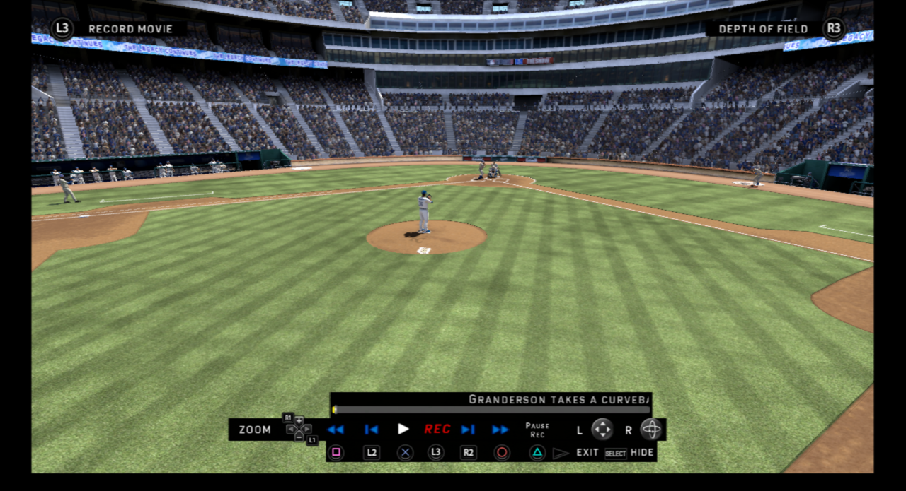
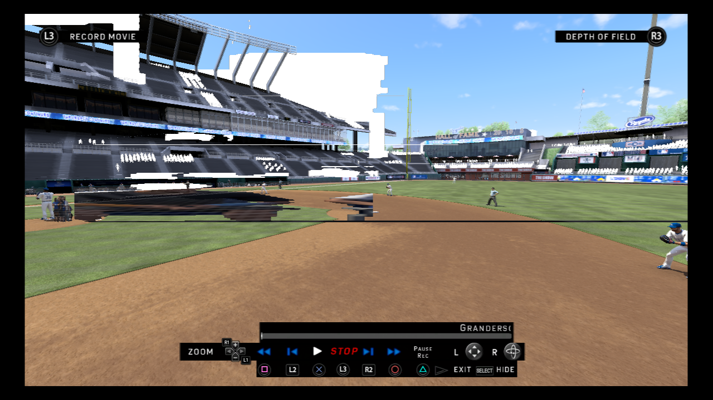
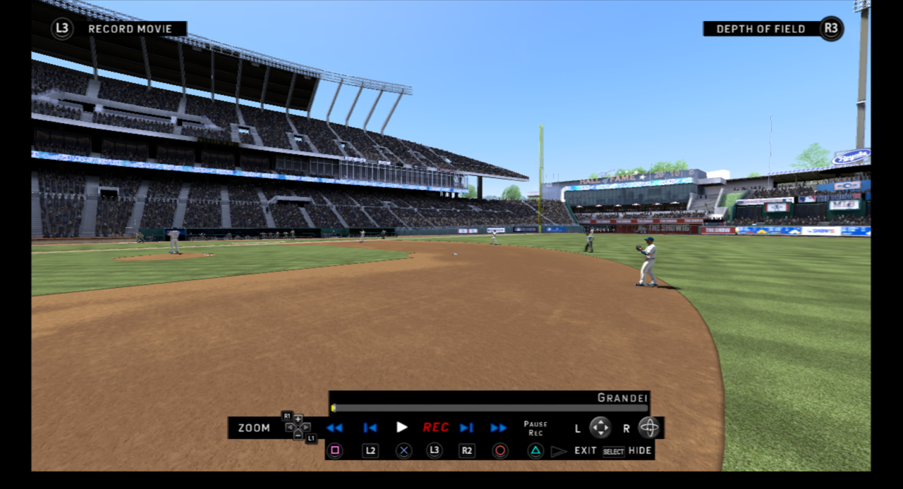
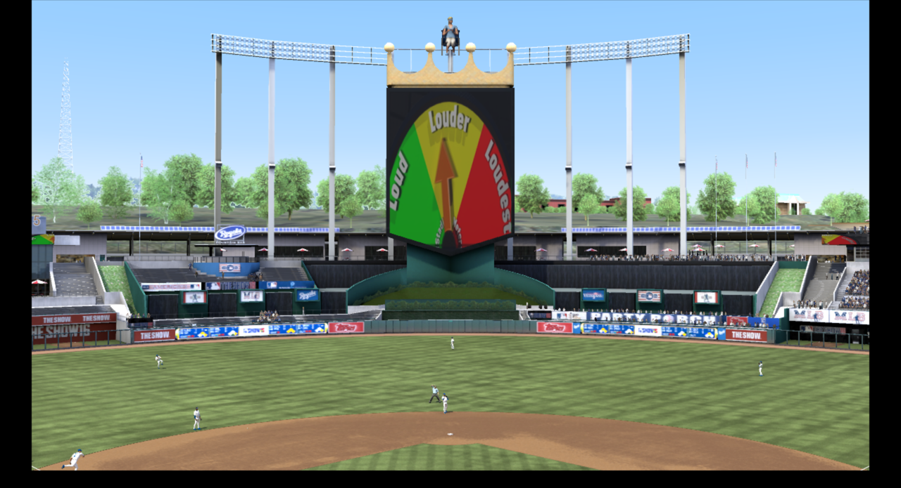
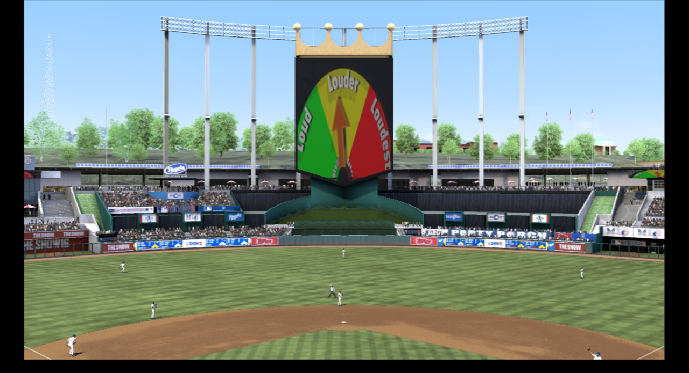

# MLB The Show 16 crowd fix for RPCS3

On RPCS3, *MLB The Show 16* has broken crowds:
- whole sections of seats are empty
- a clump of fans stands on the pitcher's mound
- huge stretched fans show up as black bars across the screen
- rows of fans float in the sky

This repo has a one-line RPCS3 game patch that fixes this, and a full write-up of how the bug was found.

| Before | After (patch v1.1) |
|---|---|
|  |  |
|  |  |
|  |  |

**The short version:**
- The game is fine. The bug is in how RPCS3 replays the crowd's draw calls: two separate bugs in `rsx::draw_clause`, both explained in the [write-up](writeup/crowd-fix.md).
- Each fan reads its seat and its picture from the wrong slice of memory, so it lands at the origin (the mound), behind the camera (the black bars), or in the sky.
- The patch makes the game draw each crowd section the simplest way it knows. That way never triggers either RPCS3 bug.

## What you need

- **RPCS3**: [rpcs3.net](https://rpcs3.net/download).
- **PS3 system firmware**: download `PS3UPDAT.PUP` straight from Sony's [PS3 system software page](https://www.playstation.com/en-us/support/hardware/ps3/system-software/), then install it with **File → Install Firmware**.
- **Your own copy of the game**, legally obtained:
  - **Disc (BCUS01089):** RPCS3 needs a *decrypted* dump.
    - Dumping the disc on your own PS3 (e.g. with multiMAN or ManaGunZ) gives you a decrypted folder or ISO directly.
    - A raw 1:1 disc image is encrypted. Decrypt it first with your disc's key (e.g. with PS3Dec).
  - **Digital (NPUA81353):** you need your own license files from your PSN account.
- **The v01.10 game update**: download it straight from Sony's update servers, then install it with **File → Install Packages/Raps/Edats**:
  - Disc version (BCUS01089): [UP9000-BCUS01089_00-MLB16THESHOWBDPA-A0110-V0100-PE.pkg](http://b0.ww.np.dl.playstation.net/tppkg/np/BCUS01089/BCUS01089_T10/07a5f28c76691db4/UP9000-BCUS01089_00-MLB16THESHOWBDPA-A0110-V0100-PE.pkg)
  - Digital version (NPUA81353): [UP9000-NPUA81353_00-MLB16THESHOWHDDM-A0110-V0100-PE.pkg](http://b0.ww.np.dl.playstation.net/tppkg/np/NPUA81353/NPUA81353_T10/e1af3ed6c162654b/UP9000-NPUA81353_00-MLB16THESHOWHDDM-A0110-V0100-PE.pkg)

## Install the patch

Works with: **MLB The Show 16, BCUS01089, game update v01.10** (PPU hash `PPU-395faa2b9c12c400d03343cad62ce7aad8ec985b`).

1. Download [`patches/MLB16_crowd_fix.yml`](patches/MLB16_crowd_fix.yml).
2. Add it to RPCS3 in one of two ways:
   - **Drag and drop:** open **Manage → Game Patches** and drop the file onto the window. RPCS3 merges it into `patches/imported_patch.yml`.
   - **By hand:** copy everything below the `Version: 1.2` line into your own `imported_patch.yml`. It lives in RPCS3's config folder, under `patches/`.
3. In **Manage → Game Patches**, expand *MLB The Show 16* and tick **"Crowd fix (single-draw crowd batches)"**. Then save.
4. Start the game.

If the patch doesn't appear under the game, you're on a different version or region. The fix idea still applies, but the address will differ. [docs/workflow.md](docs/workflow.md) shows how to find it.

The patch has only been verified on the disc version (BCUS01089). The digital version's update may have a different PPU hash. If you boot NPUA81353 and the log shows a different hash, open an issue with the hash and it can be added. Nothing in this repo contains game files.

## What's in here

| | |
|---|---|
| [writeup/crowd-fix.md](writeup/crowd-fix.md) | The full story: symptoms, how the bad draws were found in RenderDoc, how the game code was found in Ghidra, both RPCS3 bugs, the patch and how it was verified. Dead ends included. |
| [docs/setup.md](docs/setup.md) | Setting up the tools: RPCS3 + RenderDoc capture, Ghidra 12.1.2 + PS3 scripts, GhidraMCP, RenderDoc MCP. |
| [docs/workflow.md](docs/workflow.md) | The general method for chasing *any* RPCS3 graphics bug in these games, from glitch to patch. |
| [docs/rpcs3-internals.md](docs/rpcs3-internals.md) | Cheat sheet: the RSX/GCM commands that matter, how RPCS3 lays out vertex data in a RenderDoc capture, and how `draw_clause` works. |
| [docs/patching.md](docs/patching.md) | Writing RPCS3 patches: finding the PPU hash, encoding branches, testing. |
| [AGENTS.md](AGENTS.md) | Instructions for an AI coding agent (Claude Code, etc.) driving Ghidra and RenderDoc through MCP to hunt the next bug. |
| [tools/](tools/) | The Python scripts used here: RenderDoc replay helpers, EBOOT search and disassembly, a model of RPCS3's draw clause. |

## Status

- Crowd: **fixed** with patch v1.1, tested in game at Kauffman Stadium (gameplay, batting view, replays).
- Still open: a handful of small crowd batches that may still misbehave in rare shots (see the write-up), the post-game freeze, and black flashes on some camera pans.
- Upstream: a proposed fix for both RPCS3 bugs is on [my RPCS3 fork](https://github.com/MatRanc/rpcs3/commits/fix-mlb-crowd-draw-clause) (not built or tested, not a PR). A fix inside RPCS3 would cover every MLB title that draws crowds this way, without per-game patches.

## Fun fact

The whole investigation was done with Claude Code driving Ghidra and RenderDoc through MCP servers. From "the crowd is broken" to a working patch, it cost about **$30 in API usage**.

## License

Apache License 2.0 for the scripts and docs (see [LICENSE](LICENSE)). MLB The Show is © Sony Interactive Entertainment. This repo contains no game code or assets beyond short, explanatory excerpts.
